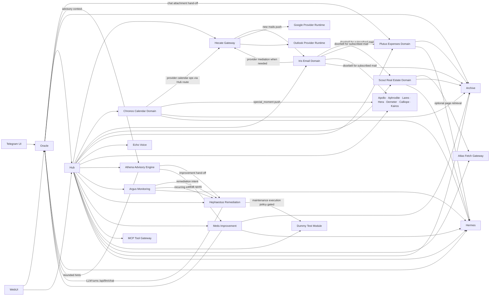

# Hestia Architecture and Flow Map

A quick, single-page reference for service roles, dependencies, and runtime data flow.

## Role Matrix

| Service | Role Type | Owns Business Logic | Owns Provider Runtime/Auth | Main Dependency Pattern |
|---|---|---|---|---|
| Hub | Core | No | No | Registry + routing for all services |
| Archive | Core | No | No | Persistent storage gateway |
| Oracle | Core | No | No | Uses Hub discovery and routes commands |
| Hermes | Core | No | No | Dispatches events/notifications (audio from Echo when the module wants voice) |
| Echo | Core | No | Speech engines only (keys `ECHO_KEY_<NAME>`) | The only caller of speech-to-text/text-to-speech; providers → chains → uses like Oracle; audio kept in Archive |
| Telegram | Interface | No | No | Telegram client: chat with Oracle, every module tool through configurable menus and guided actions, Hermes notifications, Mini App login check |
| WebUI | Interface | No | No | Web-based chat/file relay to Oracle, SignalR streaming |
| Hecate | Core Gateway | No domain logic | Yes (Google/Outlook provider runtime) | Provider-facing gateway; the one Gmail watcher (pushes new mails to Iris) |
| Chronos | Domain (Calendar) | Yes (calendar workflows + assistant agenda) | No | Routes provider calendar calls to Hecate; owns the assistant agenda |
| Iris | Domain (Email) | Yes (email workflows) | No (gateway-mediated when needed) | Email-domain APIs and commands; dispatches incoming mail to module subscriptions |
| Scout | Domain (Real Estate) | Yes (listing extraction/ranking) | No | Gets listing mails by push (Iris subscription) |
| Hercules | Domain (Fitness) | Yes (gym coach) | No | Archive store, agenda job + Hermes for reminders, WebUI plugin |
| Hygieia | Domain (Self care) | Yes (products, routines) | No | Archive store, agenda job + Hermes for reminders, WebUI plugin |
| Wardrobe | Domain (Wardrobe) | Yes (pieces, outfits, suggestions) | No | Archive store + blobs, agenda + Hermes, WebUI plugin |
| Plutus | Domain (Finance) | Yes (expenses, budgets, statements) | No | PayPal mails by push (Iris), statement PDF via plugin or chat (Oracle hand-off), Archive `finance-store`, agenda + Hermes, WebUI plugin «Spese» |
| Apollo | Domain (Images) | Yes (flows per purpose, job queue) | Yes (remote ComfyUI, `APOLLO_COMFYUI_URL`) | The only caller of image generators; ComfyUI websocket push; images in Archive blobs; `callback` push to the requester |
| Aphrodite | Domain (Appearance) | Yes (which look is on) | No | Profiles, pets, per-client choice; today's moment pushed by Chronos; asks pictures to Apollo; clients read `/now` |
| Lares | Domain (House) | Yes (devices, quick actions) | Yes (Home Assistant, `LARES_HA_URL`/`LARES_HA_TOKEN`) | The only caller of Home Assistant; websocket push of state changes; presence signal `home.present` |
| Hera | Domain (People) | Yes (cards, gifts, contacts) | No | Dates as Chronos special events (stable keys), gift ideas on `special_moment`, agenda + Hermes |
| Demeter | Domain (Nutrition) | Yes (diet, meals, supplements) | No | Coach of the weekly plan (tag `coach`), kcal estimates through Oracle, Archive `food-store` |
| Calliope | Domain (Documents) | Yes (HTML → PDF/Word/Excel + check) | No | Files in Archive blobs, tool `documento_crea`, file under the Telegram card |
| Kairos | Domain (Deadlines) | Yes (recurrence, advice, proposals) | No | Mail push (Iris) → proposals confirmed via Hermes, calendar mirror (agenda events), daily notices |
| Themis | Core | No | No | Settings registry; pushes values (and followed personal values) to modules |
| Argus | Core Organ | Yes (monitoring/remediation intent policy) | No | Reads health/logs and emits remediation intents |
| Hephaestus | Core Organ | Yes (remediation + Forge self-development) | No | Policy-gated remediation; Forge codes/tests/merges Hestia itself |
| Athena | Core Organ | Yes (proactive advisory cognition: Sistema track idle retrospective, Vita track life reflection on module signals) | No | Advisory hints for Oracle; improvement hand-off to Forge; life observations for the daily recap |
| Atlas | Shared Integration | No domain logic | No | Host-side fetch helper routed via Hub |
| Metis | Core Organ | Yes (dataset curation, benchmark, training orchestration, usage log) | No | Builds datasets from feedback, runs benchmarks, orchestrates LoRA training; usage log → «Adesso» and «Scopri» (Archive `metis-store`) |
| Dummy | Test Module | Generic integration testing behavior | No | Deterministic target for routing/policy/execution tests |
| MCP | Core Gateway | No tool-ownership (aggregates) | No | Hestia's one MCP server: every client (Oracle, Telegram, WebUI, external AIs with an access) lists and runs tools here; owns external accesses |
| Swagger | Documentation Aggregator | No | No | Canonical API contract surface (`swagger.yml`) |
| Shared | Shared Library | No | No | Common runtime/logging/startup helpers for services |

## Single Entry Point Rule (Provider Access)

1. Google and Outlook provider runtime/auth lifecycle are centralized in Hecate.
2. Domain services do not own direct provider SDK/OAuth runtime in their service boundary.
3. Domain APIs remain domain-owned:
   - Chronos owns calendar business operations.
   - Iris owns email business operations.
4. Modules get mail only by push: they subscribe at Iris (`hestia_common.mail_client`); nobody polls Gmail or logs in by IMAP.

## High-Level Dependency Graph

## Runtime Placement

| Node | Services |
|---|---|
| Raspberry Pi (always-on) | Hub, Archive, Oracle, Telegram, WebUI, Hecate, Hermes, Chronos, Iris, MCP |
| Main PC (best-effort) | Scout and other domain modules, Echo (voice engines), Metis, local LLM/runtime helpers |
| Host utility (outside Docker) | Atlas |

## Coverage Checklist

- Core: Hub, Archive, Oracle, Echo, Hermes, Telegram, WebUI, Hecate
- Domain: Chronos, Iris, Scout, Hercules, Hygieia, Wardrobe, Plutus
- Organ services: Argus, Hephaestus, Athena, Metis
- Utility/support: Atlas, Dummy, Swagger, Shared, MCP

## Practical Flows

### Calendar flow
1. Oracle/Telegram triggers calendar action.
2. Chronos handles calendar domain logic.
3. Chronos routes provider-facing calls to Hecate.
4. Hecate executes against Google/Outlook runtime.
5. Chronos persists normalized state in Archive and emits via Hermes when applicable.

### Email flow (search/send)
1. Oracle/Telegram triggers email-domain action.
2. Iris handles email domain API semantics.
3. If provider mediation/runtime is needed, flow is routed through Hecate.

### Incoming mail flow (push, no module polls)
1. Hecate watches Gmail: Chronos job `hecate.mail_watch` (default 15 min, history API) or, when configured, Gmail
   Pub/Sub streaming pull (`HECATE_GMAIL_PUBSUB_*`; the job then stays as a safety net, `hecate.mail_watch_renew` daily).
2. Hecate → Iris `POST /api/email/incoming` with the new mails' headers.
3. Iris matches them against module subscriptions (`hestia_common.mail_client`, `/api/email/subscriptions`).
4. For each match Iris stores the full mail in Archive as a raw record under the subscriber's domain (deduped), then
   rings the module `POST route/<module>/<path> {owner, key, domain, count, reference_ids}`.
5. The module processes its unevaluated records (also once at startup, so nothing is lost while it was down).
   Subscribers: Scout (listings), Plutus (PayPal receipts).

### Chat attachment hand-off
1. A file sent in chat (Telegram/WebUI) → Oracle `/api/chat/document`.
2. Oracle checks modules' `attachment_handlers` (Hub capabilities: mime + words). Match → file stored as Archive blob
   (`owner_module=chat`) → `POST route/<module>/<path>` with the blob id → the module's `{handled, text}` is the reply.
3. No match or failure → normal document analysis. Example: Hype statement PDF → Plutus preview → user confirms.

### Self-development flow (Forge)
1. User on Telegram: "aggiungi X" → Oracle (classifier: domain `system`) → tool `forge_develop` → Hub → Hephaestus.
2. Athena (idle retrospective) and Argus (recurring errors) also submit via Hub; the permission mode
   (`ask | auto | full_auto`, per group local/cloud) decides if coding starts alone.
3. Forge creates a git worktree + branch, runs the engine:
   - `local` / `cloud` → LLM turns through **Oracle `/api/llm/chat`** (Oracle owns providers and keys);
   - `claude` → Claude Code CLI inside Hephaestus.
4. Forge commits, runs the touched services' tests, notifies the user via Hub → Hermes → Telegram.
5. "approva sviluppo <id>" → merge (+ optional deploy, health check via Hub, auto rollback).

### Tool flow (one MCP for every client)
1. Each module declares its tools (`/mcp` or inline commands); Hub's discovery is read only by Hestia-MCP.
2. Oracle, Telegram and the WebUI call Hestia-MCP `/mcp` through Hub (`tools/list`, `tools/call`); Hestia-MCP builds
   the request with `hestia_common.tool_call` and routes it through Hub to the module.
3. External AI (Claude Code, Cursor…): WebUI `POST /mcp` with `Authorization: Bearer <token>` → Hub → Hestia-MCP
   `/mcp/external` → access check (Archive `mcp-access-store`, hashed token), scope, rate limit → only tools marked
   `"external"` → module with `X-Hestia-Access`; writes leave a silent Hermes inbox entry.
4. A fix made by an external AI: `forge_submit_branch` → Forge fetches the branch, tests it, asks the owner; merge
   and deploy only after the owner's approval.
5. OAuth AI (claude.ai, ChatGPT): `/mcp` 401 with `resource_metadata` → WebUI `/.well-known/oauth-*` →
   `/oauth/register` → `/oauth/authorize` (WebUI → Hub → Hestia-MCP parks the request) → browser to
   `/p/mcp/accessi?oauth=<id>` (WebUI login) → **Consenti** → code to the AI's redirect → `/oauth/token` (PKCE) →
   `hso_…` bearer on `/mcp` exactly like a token access; `refresh_token` rotates, a replay revokes the access.
6. External AI memory: `memory_note` (write access) → Hestia-MCP → Hub → Oracle `POST /api/memory/note` → Archive
   `/api/memory` (`durable_user_preference`, origin in `extra_data`); `memory_recall` reads them back. Page Memoria lists/forgets.

### Telegram flow (every function, no model in the menus)
1. Catalog: Telegram → Hub → Hestia-MCP `tools/list` (client `telegram`: input schema + `telegram_group` / `telegram`
   hints) + local actions; refreshed on Hub `registry-changed`.
2. Menu = defaults (data) + module hints + Themis `telegram.menu.layout` → bottom keyboard, Aree, area cards.
3. A tap starts a guided action: fields from the input schema (buttons for choices / `arg_picker`), confirmation for
   writes → Hestia-MCP `tools/call` → module → result card from the module's `display` block (Hestia-MCP keeps it
   only for Telegram) or the generic renderer; next-step buttons start other tools with preset arguments.
4. Reply / quote of a message + text → Oracle `/api/chat` with `quoted` (context for that turn only).
5. Mini App: «Apri» / menu button → WebUI page with `#tgWebAppData` → WebUI `POST /api/webui/auth/telegram` → Hub →
   Telegram `POST /api/webapp/verify` (bot-token HMAC, owner only) → 12-hour session token.

### Plugin flow (module pages and widgets)
1. A module with a UI declares its pages, widgets and quick actions (`hestia_common.plugin_client`) in its Hub
   registration capabilities; Hub merges them into `/api/discovery/catalog` (core modules `kind=core`).
2. Hub never registers with itself: it folds its own manifest into the catalog and answers
   `/api/route/hub/{api/ui/*, ui/*}` locally.
3. The WebUI loads each bundle through Hub and proxies the plugin's calls only under its `api_prefix`; core modules
   go under *Sistema* and their `auto` widgets build the *Sistema* dashboard.
4. `settings_panel` contributions are shown inside the module's own settings (*Impostazioni → Sistema → <module>*),
   e.g. Archive's «Backup».

### Assistant agenda flow (rules as data)
1. Modules register default rules in Chronos (`POST /api/agenda/register`, idempotent by key) at startup.
2. Windows: modules ask Chronos `GET /api/agenda/windows/{key}` before doing scheduled work (fallback if down).
3. Jobs/tasks: the Chronos agenda worker fires their action via Hub at the due time.
4. The user reads and edits the agenda from Telegram (move, pause, skip, cancel, run now); edits win over defaults.
5. The agenda (`source=hestia`) is separate from the user's calendars and never sent as user reminders.
6. Registered today: `hecate.mail_watch`, `hecate.mail_watch_renew`, `chronos.calendar_sync` (jobs); `athena.consolidation`,
   `athena.skill_curation`, `athena.thinking`, `athena.reflection`, `metis.training`, `forge.claude_nights`, `forge.claude_final`
   (windows); `metis.train.<job>`, `hephaestus.repair.<id>`, `argus.repair.<service>` (tasks); `forge.task.<id>`
   (events). Jobs keep a module-side fallback (Chronos down / job missing / stale) that never overrides a pause.
7. A rule a module no longer declares is retired by the module itself: `POST /api/agenda/retire {owner, keys}`
   (only rules it created; user items stay). Example: Scout retired `scout.email_cycle`.

### Routine and special-moment flow (dossier `docs/work/2026-10-24-tutto-brainstorm-cindy` W2)
1. A routine is a Chronos agenda rule `routine.<…>` with an instruction: by time (job → `POST /api/routines/{key}/run`),
   by mail (Chronos subscribes to Iris; Iris rings `/api/routines/mail`) or by a module signal (`/api/routines/signal`).
2. Run: optional pre-check tool through Hestia-MCP (empty → stop) → Oracle `/api/chat` with origin `routine:<key>` →
   Hermes `routine.result` (or kept for the recap in Archive `chronos-store`). `NIENTE` = nothing sent.
3. Special events: daily job `chronos.special.daily` → Hermes `special.soon` / `special.today` → `special_moment` to
   modules declaring `capabilities.special_moment_endpoint` and to routines waiting for it.
4. Smart calendar: daily job `chronos.smart_calendar` → Hermes card «Sposta alle» (→ Chronos → Hecate update) /
   «Lascia così». Registered jobs: `chronos.special.daily`, `chronos.smart_calendar`, `hermes.notifications.remind_pending`.

### Notification delivery details (same dossier, W2)
- Hermes rings only the client the owner used in the last `hermes.consegna.client_attivo_minuti` (Chronos presence);
  the others get the notification silent. When the WebUI rings, subscribed browsers also get a Web Push (`hermes-store`).
- Secret form: module event `_secret` → client form → Hermes `/api/notifications/{id}/secret` → Hub → the module.
  Hermes never stores or logs the values.

### Forge review, team and limit flow (same dossier, W3)
- Task run → tests → `reviewing`: Oracle `/api/llm/generate` (`forge.revisione`, evidence only) → blocking issues
  back to the engine once → `awaiting_review` with the review card. ≥ N services: `forge.piano` pieces first.
- Claude limit → partial commit `refs/forge/resume/<id>` → `waiting_limit` → agenda one-off `forge.resume.<id>` at the
  reset → Chronos → Hub → `POST /api/hephaestus/forge/tasks/{id}/resume`.

### Memory learning and performance flow (same dossier, W3)
- Athena consolidation → Archive memory + `athena-store` learning row; «Annulla» → Athena → Archive PATCH memory.
  Memory review → proposals → Hermes card → Athena apply/dismiss.
- Argus monitor cycle → performance sample (Docker socket read-only, Hub `/health`, Archive `/api/blobs/usage` via
  Hub) → alert worker → Hermes. Atlas recipe broken → WARNING log → Argus log alert / Forge proposal.
- Telegram export/import: Telegram → Hub → each module `/api/transfer/*` (the client orchestrates, like the WebUI).

### LLM access rule
Only Oracle talks to LLM providers. Athena/Scout/Argus/Chronos use `/api/llm/generate`, Forge and Wardrobe use
`/api/llm/chat` — always via Hub. Callers name a `use_case` `<module>.<task>` (e.g. `scout.annunci`, `athena.strategia`,
`forge.codice`) and declare it in their Hub registration (`capabilities.llm_usecases`, `hestia_common.oracle_usecases`);
Oracle maps each use case to a named chain of provider/model steps (quota skip) and a brain mode (interna / esterna =
Claude Code or Codex with Hestia's tools over MCP), all chosen in Oracle → Cervello → Modelli, never env in the caller.
Every call becomes a usage row in Archive (`llm-usage`, panel Cervello → Uso).

### Module reminder flow
1. Agenda job (Chronos) calls the module's reminder check; the module decides (enabled, goal behind, once a day,
   weekly cap).
2. Module → Hermes `api/events/ingest` with `hestia_common.reminders.reminder_event` (domain `system`, `replaces`,
   `_link`); Hermes delivers to every client of the owner; an answer is routed back to the module.

### Oracle offline flow (Oracle down)
1. Argus' monitor cycle sees Oracle down past `argus.oracle.grace` (60 s) → presence signal `oracle.offline` (Chronos
   overlay «⏳ Non disponibile», effect `chat.reply = queued`) + one Hermes notice to every client.
2. Telegram/WebUI: a chat message Oracle does not accept → Archive `/api/chat-queue` + fixed «in coda» reply.
3. Oracle healthy → Argus clears the signal and closes the notice; Chronos sees `chat.reply` back to `live` and calls each
   client's `capabilities.chat_queue_drain` via Hub; each client sends each chat's queue to Oracle in one turn
   (`queued`, the model answers each, merges or asks), then Chronos runs the «Mentre non c'ero» catch-up.
4. Only fallback models left (Oracle `/health` `models=limited`) → signal `oracle.limited`, overlay «Limitato»;
   `models=none` → same as down.
5. Any module down past `argus.repair.restart_after` → Argus → Hub → Hephaestus `/api/hephaestus/restart` (Docker),
   at most `argus.repair.max_restarts`, then one Hermes notice; incidents persist in Archive `argus-store` («Registro»).

### Assistant question flow
Oracle tool `ask_user` → turn stops, `question` frame (`ask_…`, kept in Archive `oracle-store`) → client card/buttons →
`POST /api/chat/question-answer` → `resume.message` → the client sends it as the next chat turn of the same session.
SPEC `docs/work/2026-10-19-oracle-offline` (v3).

### Layered reflection flow
1. Domain modules (Hercules, Hygieia, Plutus, Wardrobe) evaluate their own data deterministically on every write and in
   the daily agenda job `<module>.signals` → `hestia_common.signals_client` → Archive `/api/signals-store` (signals +
   weekly metrics, via Hub).
2. Window `athena.reflection` (daily 18–20): Athena reads the store, links weekly series of different areas (Pearson),
   asks the modules for details (`GET /api/module/context?topic=` via Hub), one Oracle call (`athena.riflessione`),
   relevance gate.
3. Accepted observations are stored (signals-store, `ref_id=athena`) and served as Athena's recap piece
   (`GET /api/module/recap`, «Da tenere d'occhio»); no Hermes notice. Setting ideas → Themis proposal.
SPEC `docs/work/2026-10-20-riflessione-a-livelli`.

### Backup flow (Archive → Google Drive)
1. Chronos agenda job `archive.backup` (daily) → Archive `POST /api/backup/run`: `pg_dump` from one snapshot +
   manifest → `hestia_common.crypto` (passphrase `HESTIA_BACKUP_PASSPHRASE`) → Hub → Hecate
   `/api/gateway/drive/upload/*` into `.hestia/backup` (scope `drive.file`) → retention (Themis
   `archive.backup.keep_*`). Drive away → encrypted copy waits in the Archive volume, notice via Hermes.
2. Job `archive.backup_verify` (monthly) → download, decrypt, restore into `hestia_restore_check`, compare counts.
3. Rollback (WebUI Backup panel or `tools/hestia_backup.py`) → restore into `hestia_memory_restore` → migrate →
   compare → gate (503) → rename swap, old database kept as `hestia_memory_prev` for undo → new data epoch: module
   stores answer `epoch`, module mirrors (Hercules, Hygieia, Wardrobe, Plutus) reload. SPEC
   `docs/work/2026-10-20-backup-drive`.

### Google OAuth flow
1. "collega Google Calendar" → Oracle → Hecate `POST /api/gateway/auth/initiate/google` → link (loopback + PKCE).
2. Phone: the final `localhost` page fails (expected); user pastes the URL in Telegram → Telegram forwards it
   to Hecate `complete/google` via Hub (no LLM). Host browser: Hecate's callback completes it directly.
3. Token saved to `Hestia-Hecate/data/google_token.json`, provider registry reloaded.

### Voice flows (Echo)
1. Voice note (Telegram) or voice message (WebUI) → client → Echo `/api/voice/transcribe` (use `telegram.vocale` /
   `webui.vocale`, recording kept in Archive with the message) → the text goes to Oracle like a typed message.
2. «Ascolta» under a reply → Echo `/api/voice/speak` (kept with the reply; asked again → the kept audio).
3. Live («Parla», Telegram `/voce`): mic chunks → Echo `listen` stream (partial text, silence ends the turn) → Oracle
   chat as usual → answer text → Echo `say` stream → sentences played in order. No external live service.
4. Notification in voice: module setting `<module>.notifiche.voce` → event `_voice` → Hermes publishes the text, then
   Echo `speak` (use `hermes.notifica`, kept with the notification) → `update` with `voice` to the clients.
5. Audio inside a document → Oracle → Echo (use `oracle.documenti`); Oracle has no speech engine.
6. Before any engine (W4): Echo voiceprint filter (uses in `echo.impronta.usi`: other voices → silence, also before
   the live end-of-turn check) + personal dictionary hint; a correction (`/dictionary/learn`) teaches new words.
7. Spoken diary (W4 B9): evening recap → button «Racconta la giornata» (Hygieia piece action, `command`) → Telegram
   asks a voice note → Hygieia `/api/selfcare/journal/voice` → Echo transcribe (use `hygieia.diario`) → diary
   «giornata» → reflection signal `diario`.

### Device feed flow (same dossier, W4)
- Garmin: agenda job `hecate.garmin.sync` → Hecate (garminconnect, tokens in its data folder) → `FeedPublisher`
  discovers `capabilities.feeds["wearable.daily"]` on the Hub → Hub → Hercules `/api/hercules/wearable` (activities,
  check-in) and Hygieia `/api/selfcare/wearable` (sleep); presence signal `wearable.woke_at` → Chronos.
  «Collega Garmin» → Hermes secret form → Hecate `/api/gateway/garmin/login` (password never stored).
- Phone: Tasker → tunnel → Hecate `/api/gateway/phone/push` (token) → presence signals `phone.home`/`phone.charging`
  → Chronos; app notification → feed `phone.notification` → Plutus `/api/finance/phone` (transaction to review).

### Real-estate extraction flow
1. Iris rings Scout (`/api/scout/mail`) for listing mails already stored in Archive (`real_estate`).
2. Scout runs pre-parse, dedupe, extraction, enrichment.
3. Scout writes entities to Archive and emits events to Hermes.

## Notes

- This file is a quick architecture map. Detailed endpoint contracts remain in each service `hestia-*.md` and in `Hestia-Swagger/swagger.yml`.

### W5 modules (dossier `docs/work/2026-10-24-tutto-brainstorm-cindy`)
1. People: a card's dates → Hera → Chronos `api/special` (key `hera-<id>-<n>`) → lead notice and greeting by Chronos;
   on the day `special_moment` → Hera (gift ideas notice) and Aphrodite (the owner's own moments change the look).
2. Deadlines: Hecate → Iris → Kairos `/mail` (doorbell) → proposal card in Hermes → «Aggiungi» → agenda event
   `kairos.<id>`; agenda job `kairos.daily` → lead/today notices with «Fatto» (recurring ones roll on).
3. House: Home Assistant websocket → Lares mirror; the owner's person entity → presence `home.present` → Chronos
   state «Fuori casa» (declared by Hecate with `phone.home`). Commands: tool → Lares → HA REST service.
4. Images: tool or module → Apollo job → ComfyUI `/prompt` + websocket → `/history` + `/view` → Archive blobs →
   `callback` push (e.g. Aphrodite) or Hermes notice; tool answers carry `display.files` → Telegram photo.
5. Documents: tool `documento_crea` → Calliope renders, reopens and checks → Archive blob → `display.files` →
   Telegram document.
6. Nutrition: Demeter `/api/coach/needs` (supplements as slots, «with workout») → Chronos weekly plan; intake →
   `coach.done`; meal without numbers → Oracle `demeter.stima` in the background.
