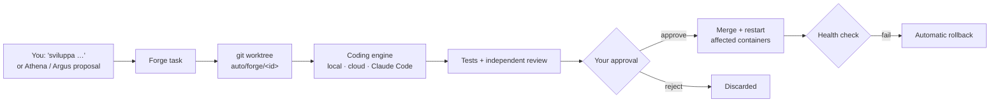

# Hestia — Setup and configuration

> The [README](../readme.md) has the short version (quick start in five steps). This page is the complete one:
> every setting you may want after the first start, the optional integrations and how to connect an external AI.
> Settings that are not secrets or infrastructure are **not** here: they live in *Impostazioni* (Themis) and you
> change them from the WebUI or Telegram.

## Installer

`install.ps1` (Windows; `Installa-Hestia.cmd` is its double-click launcher) and `install.sh` (Linux; macOS only on the
simple path, Homebrew + Docker Desktop) do, in order: check the PC (RAM, disk ≥ 20 GB, internet, virtualization,
free ports) → git → WSL2 + Docker Desktop (Windows) / Docker Engine + compose (Linux) → Ollama on the host and the
default models → Hestia in `%USERPROFILE%\Hestia` / `~/Hestia` → `.env` files (`tools/init_env.py --generate-secrets`
inside a throwaway `python:3.12-slim` container: random `HESTIA_DB_PASSWORD` on a new database and
`WEBUI_SECRET_KEY`, existing values never touched) → images → start → wait for health → browser + desktop shortcut.

| Option (`install.sh` / `install.ps1`) | What it does |
|---|---|
| none, `--update`, `--repair` / `-Update`, `-Repair` | install, or resume / repair / update an existing one |
| `--dir PATH` / `-Dir PATH` | install folder |
| `--channel stabile` (default) / `novita` | latest release with ready-made images · latest code on `main`, built locally |
| `--uninstall` / `-Uninstall` | stop and remove the containers, data kept; add `--purge` / `-Purge` (type CANCELLA) to delete data too |
| `--dry-run` / `-DryRun`, `--no-browser` / `-NoBrowser` | print the steps only · do not open the browser |

Every step retries (2/4/8 s) and has a fallback (e.g. winget → direct installer; get.docker.com → distro package;
git → zip download; pull → local build); a stop always says the one thing to do, and running the same line again
resumes. Log (no secrets): `%LOCALAPPDATA%\Hestia\install\install.log` / `~/.local/state/hestia-install/install.log`.
Telegram is started only once its token is in `Hestia-Telegram/app/.env` (otherwise it would crash-loop).
On Linux, if containers cannot reach Ollama (it listens on 127.0.0.1), the installer makes it listen on all
interfaces through a systemd drop-in and, with ufw active, allows only Docker's networks to port 11434.

**Releases and ready-made images.** A tag `vX.Y.Z` on `main` runs `.github/workflows/images.yml`: every service is
built for amd64 and arm64 and published in the single package `ghcr.io/saibboriginal/hestia` as `<service>-<version>`
and `<service>-latest`, then the GitHub Release is created. `docker-compose.images.yml` (generated by
`tools/release/images_compose.py`, kept in step by CI) points compose at them; channel `stabile` uses it, so an
install downloads instead of building. Images hold only the tag's code, never `.env` or data. The first time, the
package must be made public once on GitHub (Packages → hestia → Package settings → Change visibility).

## Manual install

```bash
git clone https://github.com/SaibboRiginal/Hestia.git && cd Hestia
python tools/init_env.py --generate-secrets --new-db   # .env files from the templates, random DB password
ollama pull gemma4:e4b && ollama pull qwen3-embedding:0.6b
docker network create hestia_net
docker compose -f docker-compose.global.yml up -d --build   # Windows: up-all.bat --build · Linux/macOS: ./up-all.sh --build
```

Then set `TELEGRAM_BOT_TOKEN` and `ALLOWED_USER_ID` in `Hestia-Telegram/app/.env` and restart Telegram.

## Configuration

Every `.env` is documented in its `.env.example`, and every compose variable has an inline comment.

### Minimum

| Where | Variable | Purpose |
|---|---|---|
| `Hestia-Telegram/app/.env` | `TELEGRAM_BOT_TOKEN` | Bot token from @BotFather. |
| `Hestia-Telegram/app/.env` | `ALLOWED_USER_ID` | Who may talk to the bot (empty = nobody, fail closed). The first id also receives reminders and alerts. |
| root `.env` | `HESTIA_DB_PASSWORD` | Postgres password (the DB port is bound to `127.0.0.1` only). |

### Optional integrations

| Feature | What to set | Notes |
|---|---|---|
| Cloud models (Gemini, DeepSeek, Claude API…) | one key per provider in `Hestia-Oracle/app/.env`: `ORACLE_KEY_GEMINI`, `ORACLE_KEY_DEEPSEEK`, `ORACLE_KEY_CLAUDE_API`… | A provider without its key is skipped by every chain; with it, its models can be steps of a chain (e.g. after the local model). |
| Different models | WebUI → Oracle → Cervello → **Modelli** | Providers (name, standard, address), chains of models (order = fallback, quota skip) and the chain/mode of every use case each module declares. Usage per module and conversation: tab **Uso**. |
| Claude Code / Codex as Hestia's brain | Modelli → «Modalità del cervello» = Esterna; `CLAUDE_CODE_OAUTH_TOKEN` (Claude) or `ORACLE_INSTALL_CODEX=1` + `codex login` (Codex) | The agent runs the loop with Hestia's tools over MCP; Hestia keeps history and memory. |
| Google Calendar + Gmail | `HECATE_ENABLE_PROVIDER_GOOGLE=true` + OAuth client in `Hestia-Hecate/app/.env` | Step by step: [`Hestia-Hecate/hestia-hecate.md`](../Hestia-Hecate/hestia-hecate.md) → *Google setup*. From the phone, ask the bot "collega Google Calendar". |
| Backup on Google Drive | `HESTIA_BACKUP_PASSPHRASE` in the root `.env` (also in a password manager: without it the backups cannot be opened) + *Google Drive API* enabled and scope `drive.file` on the Google OAuth app | Then WebUI → Impostazioni → Sistema → Archivio → Backup → «Collega Google Drive». Terminal: `python tools/hestia_backup.py list / restore / undo`. Details: [`Hestia-Archive/hestia-archive.md`](../Hestia-Archive/hestia-archive.md). |
| Home Assistant («Casa») | `LARES_HA_URL` + `LARES_HA_TOKEN` (long-lived access token) | Empty = the house is simply not connected. [`Hestia-Lares/hestia-lares.md`](../Hestia-Lares/hestia-lares.md). |
| Images («Immagini») | `APOLLO_COMFYUI_URL` (+ optional `APOLLO_COMFYUI_KEY`) of your ComfyUI | You upload the flows from the WebUI. [`Hestia-Apollo/hestia-apollo.md`](../Hestia-Apollo/hestia-apollo.md). |
| Garmin, Android phone as a sensor | nothing in env: ask «collega Garmin» (secret form, password never stored); phone via Tasker/MacroDroid | [`Hestia-Hecate/hestia-hecate.md`](../Hestia-Hecate/hestia-hecate.md). |
| llama-server (saved chat context) | `LLAMACPP_MODELS_DIR`, `LLAMACPP_MODEL` in the root `.env`, then compose profile `llamacpp` | Optional; first in the local chains when running. |
| Outlook calendar | `HECATE_ENABLE_PROVIDER_MICROSOFT=true` + `OUTLOOK_*` | Same file. |
| Claude Code as coding engine | `CLAUDE_CODE_OAUTH_TOKEN` in `Hestia-Oracle/app/.env` | From `claude setup-token` (Pro/Max). Forge then can use the `claude` engine. |
| Forge behaviour | `HEPHAESTUS_FORGE_*` in `Hestia-Hephaestus/app/.env` | Engine order, auto-rollback, deploy command. |
| WebUI hardening | `WEBUI_ADMIN_SECRET`, `WEBUI_SECRET_KEY`, `WEBUI_ICS_KEY` in the root `.env` | See [`Hestia-WebUI/hestia-webui.md`](../Hestia-WebUI/hestia-webui.md). |
| Remote WebUI access | `cloudflare-tunnel.bat` | Cloudflare tunnel to port 19015: quick (random URL) or named (`CLOUDFLARE_TUNNEL_NAME` + `CLOUDFLARE_TUNNEL_HOSTNAME`). |
| Resilient web fetching | Run Atlas on the host: `Hestia-Atlas/run_host.bat` / `run_host.sh` | Browser-assisted page fetching for modules. |
| Raspberry Pi core | `ARCHIVE_DATABASE_URL` in the root `.env`, then `docker compose -f docker-compose.rpi.yml up -d --build` | Always-on services only, external Postgres. |

## Self-development (Forge)



Permission modes per engine (`ask` · `auto` · `full_auto`) are set from Telegram, and autonomous Claude Code work
only runs inside agenda windows you control. Details: [`Hestia-Hephaestus/hestia-hephaestus.md`](../Hestia-Hephaestus/hestia-hephaestus.md).

## Connect an external AI (Collegare un'AI esterna)

Claude Code, Claude Desktop, Cursor, VS Code, Gemini CLI or Codex CLI can read Hestia's development list, add notes
and hand in fixes through MCP, without Forge or a local model doing the coding.

1. WebUI → *Sistema* → **Accessi AI** → *Nuovo token*: name it ("Claude Code PC"), pick *Solo lettura* or
   *Lettura e scrittura*, an expiry and, if you want, only some tools. The token is shown **once**.
2. Paste the ready line it shows, e.g. for Claude Code:
   `claude mcp add --transport http hestia http://localhost:19015/mcp --header "Authorization: Bearer hst_…"`
   (other clients: the JSON block on the same card).
3. Ask your AI: "elenca i task di sviluppo di Hestia", "guarda il task a1b2c3 e il suo dossier".

What it can do: `forge_tasks`, `forge_task`, `forge_task_diff`, `forge_dossier`, `forge_status`, `system_status`,
`system_log`, `settings_search`, `settings_get`; with write access also `forge_develop` (a proposal),
`forge_task_note`, `forge_submit_branch` ("fixed on this branch": Forge fetches it, runs its tests and asks you as
usual) and `settings_propose` (you confirm). Approving, merging and rolling back stay yours. Every call is logged and
writes show up silently in Notifiche; revoke or renew a token in one tap.

**claude.ai (web and phone) and ChatGPT** speak only OAuth: add a *custom connector* with the public address
`https://<your-hostname>/mcp`. The app opens Hestia, you log in to the WebUI and the **Accessi AI** page shows a
consent card ("Collegare Claude?") where you pick read or read-write, the tools and the expiry; *Consenti* sends you
back to the app. The connection shows up in the same list (badge *OAuth*): revoke it there whenever you want.

**Hestia inside Claude Code (plugin).** The repo is a Claude Code marketplace. In a terminal session of Claude Code:
`/plugin install hestia --marketplace SaibboRiginal/Hestia` (desktop app: **+** → Plugins → Add marketplace
`SaibboRiginal/Hestia` → Add plugin). Give it your public address (named tunnel below). A band appears above the
prompt with *off · strumenti · Hestia*: off by default (nothing reaches Hestia, no context used); *Hestia* makes
Claude speak as Hestia with your tone, instructions and memory, read live from Hestia; *Ricorda* saves what Claude
learned into Hestia's memory. The first switch-on asks consent on *Accessi AI*. Details: `claude-plugins/hestia/README.md`.
Working on Hestia's code with Claude Code? `hestia-dev` from the same marketplace adds the work protocol as skills and
guards on `.env` and `data/`.

**Fixed address (named tunnel).** The quick tunnel of `cloudflare-tunnel.bat` changes URL at every start; connectors
need a fixed one. Once, with a free Cloudflare account and a domain on it:

```
cloudflared tunnel login
cloudflared tunnel create hestia
cloudflared tunnel route dns hestia hestia.<your-domain>
```

then put `CLOUDFLARE_TUNNEL_NAME=hestia` and `CLOUDFLARE_TUNNEL_HOSTNAME=hestia.<your-domain>` in the root `.env`
(never in the repo). `cloudflare-tunnel.bat` then runs the named tunnel and prints the MCP address. On the same PC
you can always use `http://localhost:19015/mcp` without any tunnel.

**Servizi esterni**: third-party MCP servers Hestia may use are listed on the same page; their address and key live
only in `Hestia-Hecate/app/.env` (`HECATE_MCP_<NAME>_URL`, `HECATE_MCP_<NAME>_KEY`).
