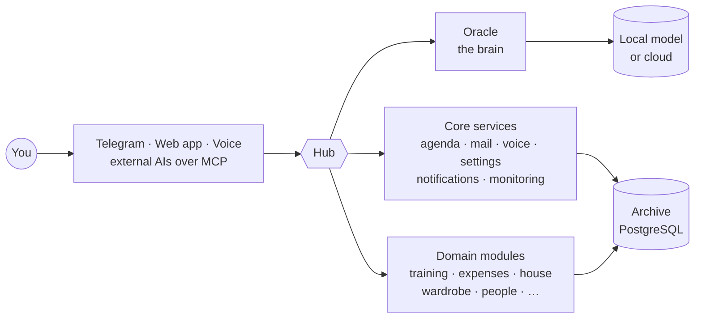

<div align="center">

<picture>
  <source media="(prefers-color-scheme: dark)" srcset="docs/assets/banner-dark.png">
  <source media="(prefers-color-scheme: light)" srcset="docs/assets/banner-light.png">
  
</picture>

<br>

**A personal AI assistant that lives on your own hardware, looks after your days and improves its own code.**

[](https://github.com/SaibboRiginal/Hestia/actions/workflows/tests.yml)


[](LICENSE)

[What it is](#what-it-is) ·
[What it does](#what-it-does) ·
[How it works](#how-it-works) ·
[Quick start](#quick-start) ·
[Using it](#using-it) ·
[Docs](#documentation)

</div>

---

## What it is

Hestia is a private assistant you run at home, on a PC, a small server or a Raspberry Pi. You talk to it in plain
language from **Telegram**, from its **web app** or by **voice**, and it takes care of your calendar, mail, training,
expenses, house and much more. It thinks with a **local model** by default and can use cloud models when you want.

<table>
<tr>
<td width="33%" valign="top">

**Private by design**<br>
Your data stays in your database, on your machine. Cloud models and services are optional, one key at a time.

</td>
<td width="33%" valign="top">

**One assistant, many skills**<br>
Every area of your life is a small module. Add one and the assistant can use it everywhere, at once.

</td>
<td width="33%" valign="top">

**It improves itself**<br>
Say *«sviluppa …»* and Hestia writes the change, tests it, asks you, deploys it and rolls back if it breaks.

</td>
</tr>
</table>

## What it does

| Area | In short |
|---|---|
| **Talk** | Chat with visible reasoning and tools, voice in and out, files and photos understood, long-term memory you can review. |
| **Plan** | Google and Outlook calendars, the assistant's own agenda, a weekly plan built around your events, routines in words, deadlines, a morning and evening recap. |
| **Look after you** | Gym coach, self care, nutrition, wardrobe and outfits from the weather, important people and their dates. |
| **Money and home** | Expenses from mails and bank statements with budgets, Home Assistant lights and scenes, real-estate listings from mail. |
| **Create** | Real PDF, Word and Excel documents, images through your ComfyUI. |
| **Keep itself well** | Health monitoring with automatic repair, nightly encrypted backup on Google Drive, export and import of your data. |
| **Be proactive** | Notifications only where you are, «Adesso» (what you usually do now), «Scopri» (what you never tried), ideas from idle reflection. |

Each area has its own page in the web app and its own menu on Telegram: everything you can do in one client, you
can do in the other.

## How it works



Hestia is a set of small services in Docker, each with one job:

- **Hub** is the only door: services find and call each other only through it.
- **Oracle** is the only one that talks to AI models; **Echo** the only one that listens and speaks.
- **Archive** is the only owner of the database; **Hecate** the only one that talks to Google, Microsoft and the
  other outside providers.
- **Themis** keeps every setting in one place: the assistant may propose a change, you confirm it.

New skills are new modules, generated from a template, that plug into all of this by themselves. The full picture,
module by module: [architecture and rules](docs/ARCHITECTURE.md) · [dependency and flow map](architecture-and-flow-map.md).

## Quick start

**You need** Docker with Compose v2, Python 3, [Ollama](https://ollama.com) on the host and a Telegram bot token
from [@BotFather](https://t.me/BotFather) (plus your numeric Telegram id, e.g. from [@userinfobot](https://t.me/userinfobot)).

**1. Clone and create the env files**

```bash
git clone https://github.com/SaibboRiginal/Hestia.git
cd Hestia
python tools/init_env.py        # copies every .env.example to .env, never overwrites
```

**2. Fill in three values**

```dotenv
# Hestia-Telegram/app/.env
TELEGRAM_BOT_TOKEN=<token from @BotFather>
ALLOWED_USER_ID=<your numeric Telegram id>

# .env (repository root)
HESTIA_DB_PASSWORD=<a long random password>
```

**3. Pull the local models**

```bash
ollama pull gemma4:e4b
ollama pull qwen3-embedding:0.6b
```

**4. Start**

```bash
docker network create hestia_net
docker compose -f docker-compose.global.yml up -d --build
```

On Windows `up-all.bat --build` does both.

**5. Say hi** to your bot on Telegram, then send `/webui_token` for a login link to the web app.

> **Just want to look around?** Open it in a [GitHub Codespace](https://codespaces.new/SaibboRiginal/Hestia): the
> whole stack starts by itself and prints a login link. See [TESTING.md](TESTING.md#banco-di-prova-cloud-whole-stack-no-local-pc).

## Using it

| Where | How |
|---|---|
| **Telegram** | The main client. Keyboard *Oggi · Aree · Notifiche · Impostazioni*, voice notes, guided actions with confirmation. |
| **Web app** | <http://localhost:19015>: chat, a page for every area, calendar, settings, development tasks. Opens inside Telegram too. |
| **Voice** | Speak in either client, listen to any answer, or use the live mode and talk back and forth. |
| **External AIs** | Claude, ChatGPT, Cursor and other MCP clients can connect with a token you create in *Sistema › Accessi AI*. |
| **API** | Swagger for every service at <http://localhost:19000>. |

Everything beyond the first start (cloud models, Google Calendar and Gmail, Drive backup, Home Assistant, remote
access, connecting an external AI) is in **[docs/SETUP.md](docs/SETUP.md)**.

<details>
<summary><b>All modules</b></summary>

<br>

| Module | Port | Role |
|---|---|---|
| [Hub](Hestia-Hub/hestia-hub.md) | 19001 | Service registry and the only router |
| [Archive](Hestia-Archive/hestia-archive.md) | 19002 | The only database owner: memory, chat, calendar items, documents, every module's data |
| [Hecate](Hestia-Hecate/hestia-hecate.md) | 19003 | Outside providers: Google and Microsoft, Gmail, Drive, weather, Garmin, phone |
| [Oracle](Hestia-Oracle/hestia-oracle.md) | 19004 | The brain: agent loop, model chains, memory, Claude Code runner |
| [Hermes](Hestia-Hermes/hestia-hermes.md) | 19005 | Notifications and confirmations to your clients |
| [Scout](Hestia-Scout/hestia-scout.md) | 19006 | Real-estate listings from mail |
| [Chronos](Hestia-Chronos/hestia-chronos.md) | 19007 | Calendars, the assistant's agenda, weekly plan, routines |
| [Argus](Hestia-Argus/hestia-argus.md) | 19008 | Health, logs and performance monitoring |
| [Athena](Hestia-Athena/hestia-athena.md) | 19009 | Idle reflection, ideas, daily recap |
| [Hephaestus](Hestia-Hephaestus/hestia-hephaestus.md) | 19010 | Guarded repairs and **Forge** (self-development) |
| [Dummy](Hestia-Dummy/hestia-dummy.md) | 19011 | Integration-test target |
| [Iris](Hestia-Iris/hestia-iris.md) | 19012 | Mail: delivers new messages to the modules that asked |
| [MCP](Hestia-MCP/hestia-mcp.md) | 19013 | The one tool catalog for every client and external AI |
| [Metis](Hestia-Metis/hestia-metis.md) | 19014 | Datasets from feedback, benchmarks, LoRA training |
| [WebUI](Hestia-WebUI/hestia-webui.md) | 19015 | .NET 9 + Angular web app |
| [Themis](Hestia-Themis/hestia-themis.md) | 19016 | Central settings |
| [Wardrobe](Hestia-Wardrobe/hestia-wardrobe.md) | 19017 | «Guardaroba»: clothes, outfits, packing |
| [Hygieia](Hestia-Hygieia/hestia-hygieia.md) | 19018 | «Cura di sé»: routines, products, diary |
| [Hercules](Hestia-Hercules/hestia-hercules.md) | 19019 | «Allenamento»: gym coach and outdoor activities |
| [Plutus](Hestia-Plutus/hestia-plutus.md) | 19020 | «Spese»: expenses, budgets, subscriptions |
| [Echo](Hestia-Echo/hestia-echo.md) | 19021 | Voice: speech to text and text to speech |
| [Apollo](Hestia-Apollo/hestia-apollo.md) | 19022 | «Immagini»: images through ComfyUI |
| [Aphrodite](Hestia-Aphrodite/hestia-aphrodite.md) | 19023 | «Aspetto»: themes for holidays and seasons, a pet |
| [Lares](Hestia-Lares/hestia-lares.md) | 19024 | «Casa»: Home Assistant |
| [Hera](Hestia-Hera/hestia-hera.md) | 19025 | «Persone»: important people, dates, gift ideas |
| [Demeter](Hestia-Demeter/hestia-demeter.md) | 19026 | «Alimentazione»: diet, meals, supplements |
| [Calliope](Hestia-Calliope/hestia-calliope.md) | 19027 | «Documenti»: PDF, Word and Excel files |
| [Kairos](Hestia-Kairos/hestia-kairos.md) | 19028 | «Scadenze»: bills, insurance, renewals |
| [Telegram](Hestia-Telegram/hestia-telegram.md) | — | Main chat client |
| [Atlas](Hestia-Atlas/hestia-atlas.md) | host | Web page fetching, runs outside Docker |
| [Shared](Hestia-Shared/hestia-shared.md) | — | `hestia_common`, the libraries every Python service uses |
| [Swagger](Hestia-Swagger/swagger.yml) | 19000 | API contract of every service |

</details>

## For developers

```bash
python -m pytest -q -m "unit or api or format" Hestia-Oracle/tests   # fast tests of one service, no network
python tools/cloud_test.py all                                       # the whole stack, end to end
create-service.bat Markets module 8012                               # scaffold a new module (Windows)
```

```
Hestia-<Name>/              one service: app/, tests/, hestia-<name>.md, Dockerfile
Hestia-Shared/hestia_common shared libraries
Hestia-WebUI/               .NET 9 backend (app/) + Angular frontend (frontend/)
docs/                       architecture, setup, rules, task dossiers (work/)
tools/                      setup, test bench, governance checks
```

Every change follows a short work protocol (spec, progress and changelog in `docs/work/`) described in
[CLAUDE.md](CLAUDE.md), written for AI developers and readable by humans. CI runs every service's tests and the
governance checks that keep docs, API contract and code in sync.

## Documentation

| Topic | Where |
|---|---|
| Setup, configuration, integrations | [docs/SETUP.md](docs/SETUP.md) |
| Architecture, rules and contracts | [docs/ARCHITECTURE.md](docs/ARCHITECTURE.md) · [flow map](architecture-and-flow-map.md) |
| Each module | `Hestia-<Name>/hestia-<name>.md` (links in *All modules* above) |
| API | [Hestia-Swagger/swagger.yml](Hestia-Swagger/swagger.yml) |
| Product rules | [docs/REGOLE-DI-MARKO.md](docs/REGOLE-DI-MARKO.md) |
| Testing | [TESTING.md](TESTING.md) |
| For AI developers | [CLAUDE.md](CLAUDE.md) → [docs/AI-GUIDE.md](docs/AI-GUIDE.md) |
| History | [CHANGELOG.md](CHANGELOG.md) |

## License

[MIT](LICENSE)
